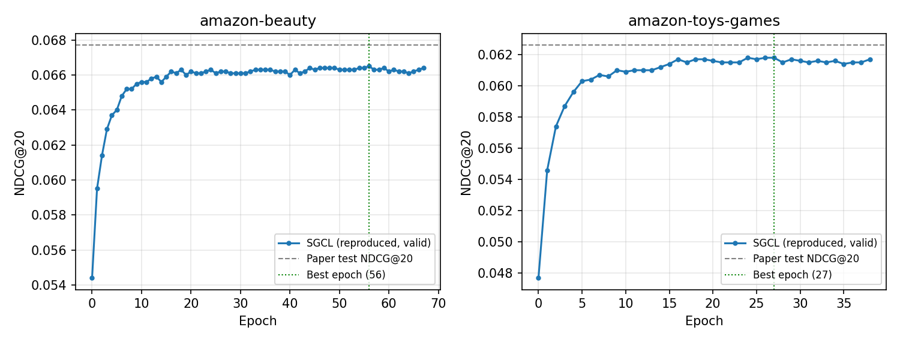

# SGCL reproduction results

Reproduction of Table 2 (SGCL row) from *SGCL: Unifying Self-Supervised and Supervised Learning for Graph Recommendation* (RecSys '25), using the authors' code in this repository.

Run date: 2026-10-25 · Hardware: Apple M1, 8 GB RAM, **CPU only** (no CUDA GPU)

## Test results vs. paper

| Dataset | Metric | Paper | Reproduced | Diff |
|---|---|---|---|---|
| Beauty | Recall@20 | 0.1410 | 0.1431 | +0.0021 |
| Beauty | NDCG@20 | 0.0677 | 0.0689 | +0.0012 |
| Beauty | Recall@50 | 0.2105 | 0.2121 | +0.0016 |
| Beauty | NDCG@50 | 0.0807 | 0.0831 | +0.0024 |
| Toys-and-Games | Recall@20 | 0.1317 | 0.1322 | +0.0005 |
| Toys-and-Games | NDCG@20 | 0.0626 | 0.0636 | +0.0010 |
| Toys-and-Games | Recall@50 | 0.1965 | 0.1951 | −0.0014 |
| Toys-and-Games | NDCG@50 | 0.0774 | 0.0764 | −0.0010 |

All 8 metrics are within 0.0025 of the paper, and SGCL still beats every baseline in Table 2 on every metric.

## Training

| Dataset | Best epoch | Epochs run | Paper epochs | Avg. train time / epoch |
|---|---|---|---|---|
| Beauty | 56 | 68 | 62 | 32.6 s (CPU) |
| Toys-and-Games | 27 | 39 | 35 | 23.3 s (CPU) |

Per-epoch times are not comparable to the paper's Table 3 (~2 s/epoch on GPU).



## Setup

- Hyperparameters unchanged from the repo: batch size 1024, embedding size 64, 3 layers, temperature 0.2, lr 0.001, Adam, early stopping 10 epochs on validation NDCG@20, seed 2020.
- Data: 5-core filtering, random 8:1:1 split, full-ranking evaluation.
  - Beauty: 22,363 users, 12,101 items, 198,502 interactions
  - Toys-and-Games: 19,412 users, 11,924 items, 167,597 interactions
- Environment: Python 3.10.14, torch 2.2.2, recbole 1.2.0, torch_geometric 2.5.3 (full list in `environment.txt`).

## Changes to the original code

1. `recbole_gnn/config.py`: skip `torch.cuda.set_device` when CUDA is unavailable; it crashed on non-NVIDIA machines.
2. `recbole_gnn/utils.py`: RecBole 1.2.0 stores `eval_args.mode` per phase (`{'valid': 'full', 'test': 'full'}`), so the `== "full"` check always failed and evaluation fell back to sampled mode and crashed. The check now reads the per-phase value.
3. `config.yaml`: `topk: [20]` → `topk: [20, 50]` so the @50 metrics are reported. Model selection still uses NDCG@20.
4. Datasets: RecBole's download server returns 403, so the `.inter` files were built from the original 2014 McAuley `ratings_Beauty.csv` and `ratings_Toys_and_Games.csv` (snap.stanford.edu) with RecBole's `Amazon_ratings` schema. Raw row counts match RecBole's published stats.

## Why the numbers aren't identical

The paper ran on a GPU and this run used a CPU, so floating-point results differ slightly and shift which epoch early stopping picks. The paper also doesn't list its library versions.

## Files

| File | Contents |
|---|---|
| `comparison_with_paper.csv` | The table above |
| `summary.json` | Best epoch, best validation and test metrics (incl. Hit, Precision, MRR) |
| `*_per_epoch_validation.csv` | Loss, timing, and all validation metrics per epoch |
| `ndcg20_curves.png` | Validation NDCG@20 per epoch |
| `logs/` | Full RecBole training logs |
| `checkpoints/` | Best-epoch model weights (`.pth`) |
| `run_config.yaml`, `SGCL_model_config.yaml` | Configs used |
| `environment.txt` | `pip freeze` of the environment |

## Reproduce

```bash
.venv/bin/python run_recbole.py -m SGCL -d amazon-beauty
.venv/bin/python run_recbole.py -m SGCL -d amazon-toys-games
```
